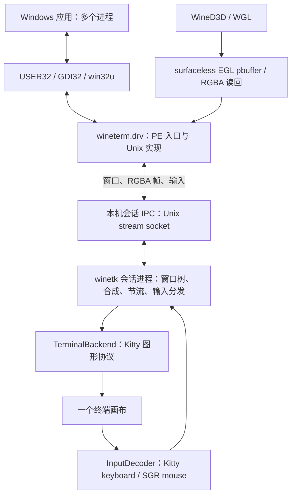

# 架构与源码接入点

这是整体开发方案。M1 已实现 CPU 帧后端、终端生命周期、输入解析和独立测试画布，见 `include/winetk/` 与 [原型说明](TERMINAL-DEMO.md)。
M2 已实现 `wineterm.drv`、有界 Unix stream IPC、最小多进程合成与硬件输入桥接，见 `include/winetk/wine*.h`、`src/session/wine.c` 和 [实测](reports/M2-RESULTS.md)。下文仍包含完整 GDI 会话与 GPU 阶段的目标设计，不能将目标语义视为已经完成。
本轮已实现协议 v2 的客户区画布、动态尺寸，以及 OpenGL/WineD3D 的 surfaceless EGL 读回；GDI、WGL 与真实 D3D8 游戏验证见 [本轮记录](reports/M3-RESULTS.md)。

## 显示和输入链路

显示驱动不自己抢占终端；只有会话进程持有控制 TTY。Wine 各进程可能包含 explorer、应用、对话框宿主，必须共享会话中的合成状态。
当前通过继承的显式会话地址将子进程接到同一会话；socket 位于当前用户私有 runtime 目录，检查对端 UID/PID 凭据和窗口归属。独立 prefix 与会话绑定，避免误把已有 Wine 会话的窗口纳入当前终端。

## 已核对的 Wine 11.19 接入点

基线：`455e3509b98a6919fd4ad1def4803e08c41c03b2`，`WINE_GDI_DRIVER_VERSION = 110`。
这些属于 Wine 内部 ABI，应随版本固定，不假定系统 Wine 可以直接加载任意版本驱动。

| 源码路径 | 接入价值 |
| --- | --- |
| `include/wine/gdi_driver.h` | `user_driver_funcs`、`window_surface_funcs`、`window_surface_create`；显示与窗口驱动契约 |
| `dlls/win32u/driver.c` | 驱动加载、空驱动行为、`__wine_set_user_driver` 注册和默认函数填补 |
| `dlls/win32u/dce.c`, `window.c` | 软件 surface、裁剪与 flush 机制；确定脏区语义及缓冲生命周期 |
| `dlls/winewayland.drv/waylanddrv_main.c` | PE/Unix 驱动注册与 WoW64 调用表的结构参考 |
| `dlls/winewayland.drv/window_surface.c` | `CreateWindowSurface` 与 `flush` 的现有实现参考 |
| `dlls/winewayland.drv/display.c` | 虚拟 GPU、source、monitor、mode 的枚举入口参考 |
| `dlls/winewayland.drv/dllmain.c`, `Makefile.in` | 驱动模块及 Unix library 的构建参考 |
| `programs/explorer/desktop.c` | 桌面初始化、显示驱动选择和注册信息 |
| `dlls/win32u/input.c`, `server/queue.c` | 输入与消息队列；为跨进程 focus/capture/event 唤醒制定桥接方式 |

Wayland/X11 驱动仅用作结构参考，新驱动不能保留对其宿主窗口/连接的依赖。
上游空驱动在 `win32u/driver.c` 内，不存在可直接扩展的 `dlls/winenull.drv` 模块。
仅编译 `--without-x --without-wayland` 不会自动产生终端驱动。

驱动已命名为 `wineterm.drv`，在 Wine 树内构建，模块和配置条目随补丁更新。
已确认 explorer 会读取 `HKCU\Software\Wine\Drivers` 的 `Graphics` 值，并将 `term` 映射为 `wineterm.drv`；也有 `/desktop=name,widthxheight,driver` 显式选择路径。
M2 已验证该注册值与独立 prefix 初始化；连接地址通过 `WINETK_SOCKET` 继承给所有 Wine 子进程。

GDI 首选 `pCreateWindowSurface` 创建软件 surface，在 `window_surface_funcs.flush` 获取像素、脏区和 shape 信息；
同时实现显示设备、窗口几何与生命周期、焦点/捕获以及事件处理需要的入口。
核对 `BITMAPINFO` 的通道掩码、stride、上下方向、alpha/shape 语义后再转为统一像素格式，不能将所有 `color_bits` 直接视为 RGBA。
flush 期间复制或发布有明确生命周期的快照，不能把 Wine 临时指针跨进程传递。
当前 surface flush 直接复制整帧并向 broker 发送，有 250ms 绝对超时；不会直接等待终端写入，但仍可能因 broker 背压短暂阻塞，后续应改为有界队列。

当前只发布客户区像素，丢弃 Wine 非客户区边框和标题栏。虚拟显示模式与终端画布分开管理：显示设备枚举常用 16/32 bpp 模式并处理 `ChangeDisplaySettings`；画布尺寸直接采用启动进程最大可见客户区的报告尺寸，输入坐标加回其虚拟桌面原点。原始位置和非客户区外框仍保留在窗口元数据中。
Wine 模式默认 60 fps；显示频率通过 `WINETK_FPS` 传入，终端 `--fps` 可设置 1..240。这个值是节流和模式报告配置，不能作为实际游戏帧率的测量结果。

## 会话、合成与后端契约

IPC 使用版本化 Unix stream 帧，校验长度、版本、类型、尺寸、像素总量和句柄归属；完整会话设计还需要 generation 与严格顺序规则。
当前实现是小端协议 v2：16 字节头，FRAME/WINDOW 的 48 字节元数据同时携带外框/传输区和完整客户区坐标；FRAME 随后是紧密排列、从上到下的 RGBA8。版本与尺寸不匹配会拒绝连接，不能混用 M2 的 v1 驱动。generation、完整窗口树与严格全局 Z 序仍是后续契约。
生命周期、几何与 focus/capture 消息保序；共享像素缓冲使用提交序号和所有权规则防止读写撕裂。
窗口移动/销毁后同时使旧、新区域变脏，窗口句柄复用不能误命中过去的 surface。
断线应回收对应连接的窗口与缓冲，不得拖垮仍在运行的其他进程。

完整合成器将维护逻辑桌面、可见区域、Z 序、layered alpha、弹窗和软件光标。当前是按元数据/前台标记排序的不透明客户区合成，尚未覆盖这些完整语义。
首先实现保守的整帧合成，再引入脏区；跨进程 Z 序和焦点以 Wine 的状态为准，不能简单按 IPC 到达时间排序。
图像格式与帧脏区属于中间契约，Kitty 转义序列只能出现在 Kitty 后端内。

| 草案接口 | 责任 |
| --- | --- |
| `probe(tty, deadline) -> capabilities` | 图形、像素尺寸、输入、同步更新等能力，含超时与应答解析 |
| `open(config)` / `close()` | 管理本会话的终端状态和图像资源 |
| `resize(viewport)` | 处理像素和字符尺寸变化及坐标转换 |
| `present(frame, damage, sequence)` | 提交不可变、明确格式/stride/尺寸的画面，报告背压与错误 |
| `poll_event(deadline)` | 返回规范化输入、resize、focus 及协议响应事件 |

统一接口接受 CPU 像素帧；当前 GDI 和 GPU 读回已经复用这个契约。GPU 读回目前同步进行，异步 staging/PBO 仍待实现。
不提前把 GPU handle 传给 Kitty，也不把具体渲染 API 写入终端后端接口。
帧队列有界，可合并旧画面更新并保留最新状态，不能丢窗口销毁、按键释放等控制事件。

## Kitty 输出与输入

- 使用真实 query/应答与像素尺寸探测；`TIOCGWINSZ` 像素字段为零时再查询 CSI 窗口/字符像素尺寸。协议响应与键鼠事件由同一解析器分流。
- 第一阶段采用 `t=d` 直接传输 RGB/RGBA，Base64 编码块不超过 4096 字节，按 `m=1/0` 完整发送；不可在一幅图的分块间插入另一幅图形命令。
- 当前 Wine 模式会另发 `a=q,t=s` 探测本机 POSIX 共享内存，仅收到匹配 ID 的成功应答后启用。每帧发布不可变 RGBA 对象并发送名称，Kitty 消费后 unlink；最多保留四帧和一个探测对象。队列满、分配失败或不支持时回退到 `t=d`，大帧按需使用 zlib level 1。录制强制直传，使协议记录可独立回放。
- 当前整帧替换，直传支持 Kitty `o=z` 的 zlib 快速压缩，无压缩收益时回退原始 RGBA；本机共享内存传输的验证和最终默认值见本轮记录。Kitty 的裁剪/placement 参数不能直接视为任意脏矩形写回命令；使用动画帧局部更新前须验证能力、缓存和兼容性。
- 独立分配 image/placement ID，仅释放本会话资源。避免滚屏；同步更新能力可用时再启用，结束序列不可遗漏。
- 键盘采用 Kitty keyboard protocol，协商按下/重复/释放和修饰键；文字与物理键分别处理，不能以 Unicode 文本模拟全部快捷键。
- 鼠标采用 SGR 事件，支持时启用像素坐标；否则报告字符格精度限制。用与显示相同的缩放、留边、DPI 变换映射到逻辑桌面。
- focus out、断线和退出时释放按键/鼠标状态；设计可配置的本地退出手势，避免应用抢占后无法退出。
- 增强方向键显式使用带 E0 标志的物理扫描码，避免 Wine 默认映射把方向键变成数字小键盘；真实 i386 DirectInput 8 `GetDeviceState` 已检查按住/释放及对应 numpad 状态。轮询输入的游戏需要实际按住按键，瞬时按下/释放不足以验证游戏输入。
- 程序输出、Wine 调试日志写文件或独立管道；单纯使用 stderr 仍可能污染同一个 TTY。

## 游戏与 GPU 边界

Direct3D/OpenGL 绘制通常不会经过 GDI surface flush，GDI 路线不能自动覆盖游戏。
`pOpenGLInit` 和 `client_surface` 的路径已经接入：固定 `EGL_PLATFORM_SURFACELESS_MESA`，使用 EGL pbuffer 作为 drawable；在 flush/swap 时读回 RGBA、翻转上下方向，再提交同一窗口帧。不解析宿主显示地址，也不创建 X11/Wayland 窗口。
读回保存并恢复 framebuffer、read buffer、pixel-pack buffer 与 pack 参数，避免改变 WineD3D 应用状态；NVIDIA/Mesa 的默认 pbuffer buffer 选择不同，因此根据实际 host buffer 建立映射。双架构 WGL resize 验证覆盖该生命周期。
该路径已实际运行 D3D8 东方红魔乡，并通过双架构 D3D11 像素/resize 和 Unity Mono/IL2CPP 标题界面验证，见 [Unity 记录](reports/M4-UNITY-RESULTS.md)。`pVulkanInit`、Vulkan 离屏 image/WSI 路径还未实现。
Vulkan headless 扩展、DXVK/vkd3d 并不等于开箱即用的无宿主窗口呈现，需要验证 WSI、格式、同步、resize 和驱动扩展支持。
当前 WGL 实测使用本机 Tesla V100 硬件 OpenGL 4.6；后续继续评估异步 staging/readback、帧率和带宽。

1280×720 RGBA、30 fps 的整帧直传在 Base64 后约为 147 MB/s（约 141 MiB/s），尚未计转义序列。
终端输出可能成为主要瓶颈，因此必须测量后再设帧率与分辨率目标，不能预先承诺游戏 60 fps。

## 资料

- Wine 源码与版本历史：https://gitlab.winehq.org/wine/wine
- 本轮使用的 Wine 镜像：https://github.com/wine-mirror/wine/tree/wine-11.19
- Kitty 图形协议：https://sw.kovidgoyal.net/kitty/graphics-protocol/
- Kitty 键盘协议：https://sw.kovidgoyal.net/kitty/keyboard-protocol/
- 本机对应文档：`/usr/share/doc/kitty/html/_sources/graphics-protocol.rst.txt`、`keyboard-protocol.rst.txt`。
